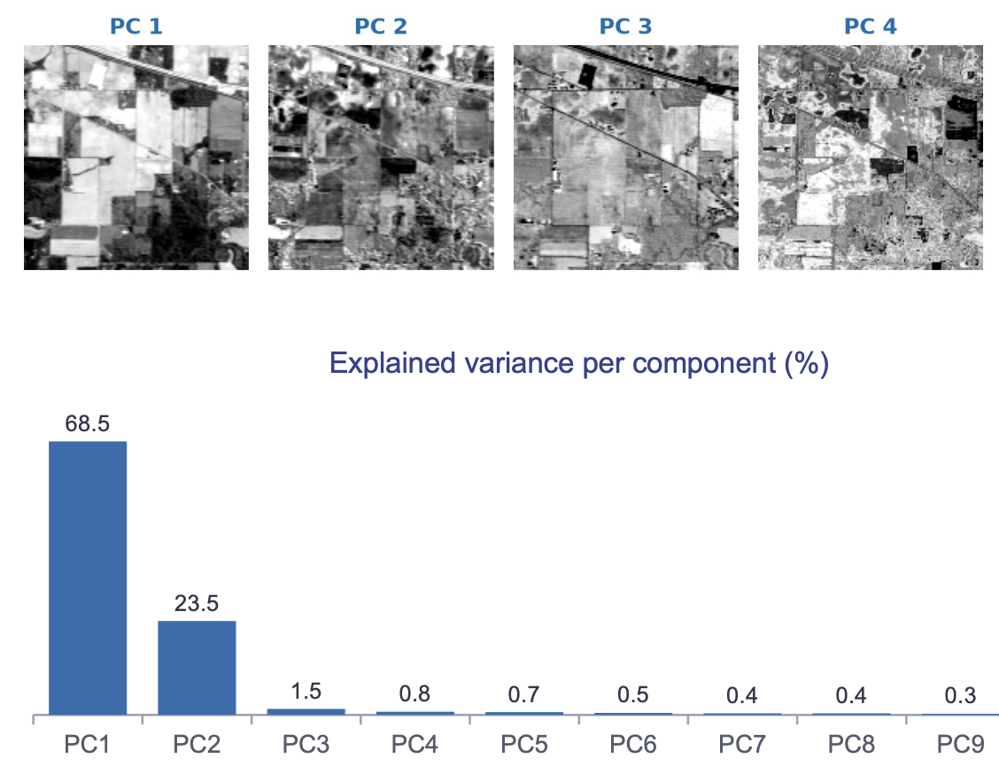

In this  week, we will learn about *principal components analysis* and  *minimum noise fraction*, two established techniques for hyperspectral image analysis.

## 👨‍🏫 Lecture

[PCA vs MNF](https://drive.google.com/file/d/1Nix9o4iyAW2VCYNh0xZGqUP8IcEEai0H/view?usp=sharing)

## Practical exercise

Reproduce this Jupyter notebook:

[PCA and MNF for hyperspectral image analysis](https://drive.google.com/file/d/1rpq1vRLnK4wIW51pTjkp1A8ka98sAroa/view?usp=sharing) 

## Recommended reading

[Comparison of dimensionality reduction methods on hyperspectral images](https://drive.google.com/file/d/10TX5YtFwCh0zHi9TF8BHdGkPsRcLK197/view?usp=sharing)

