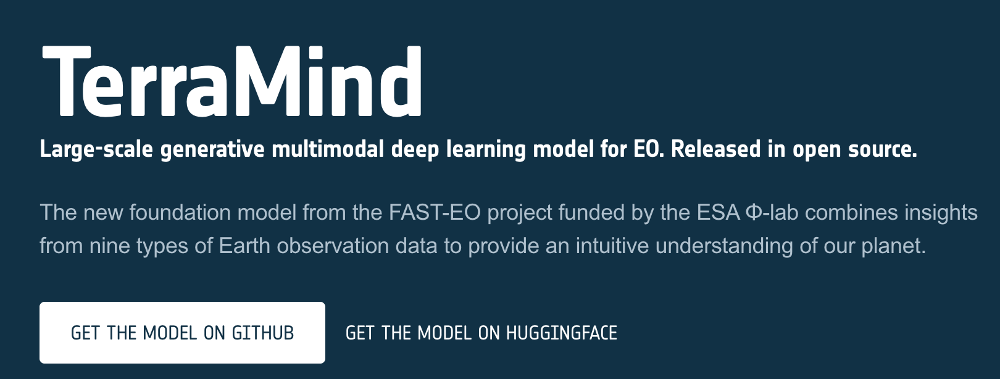
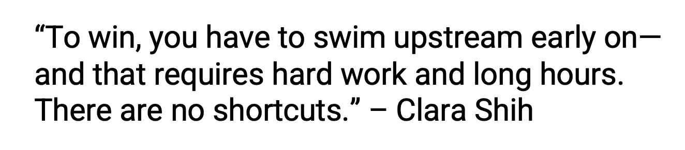

In this  week, we will get familiar with *TerraMind* a large-scale generative multimodal deep learning model for EO. 

## 👨‍🏫 Theory

[Video lecture](https://www.youtube.com/watch?v=yHRLtzT7R0Q)

## 👨‍🏫 Practical

Work on your *Informe No. 2*. Make sure your document provides evidence about: (i) your understanding of the image processing & analysis techniques you applied; and (ii) your commitment to *reproducible research*.

Make sure you upload your *Informe No. 2* not later than  9th December at 11:59 pm. 

## 👨‍🏫 Reading

[TerraMind: Large-Scale Generative Multimodality for Earth Observation](https://arxiv.org/pdf/2504.11171)